# Architecture and System Design

This document explains the Property AI Assistant at three levels, each with diagrams:

1. [Business view](#1-business-view): who uses it, what problem it solves, how it creates value
2. [Technical architecture](#2-technical-architecture): the main building blocks and how data moves
3. [Detailed system design](#3-detailed-system-design): components, request flow, algorithms,
   failure handling, data model and deployment

The diagrams are written in [Mermaid](https://mermaid.js.org/), which GitHub renders
automatically. To edit one, paste it into https://mermaid.live.

---

## 1. Business view

### 1.1 Business context

Property buyers and investors have to search two very different sources: a developer's
marketing site (DarGlobal: international branded residences) and a property portal (Wasalt:
thousands of individual Saudi listings). The assistant puts both behind one conversation,
answers in plain language and links back to the original pages. It sends people to the
sources rather than replacing them.

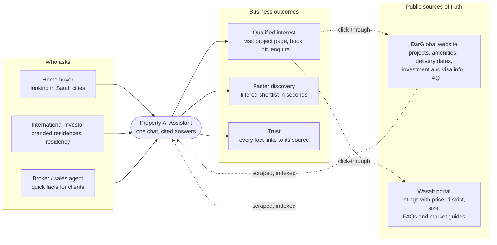

### 1.2 Use cases

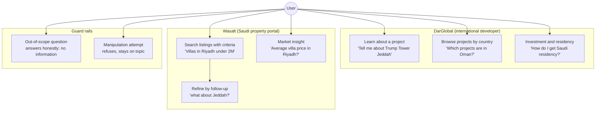

### 1.3 User journey

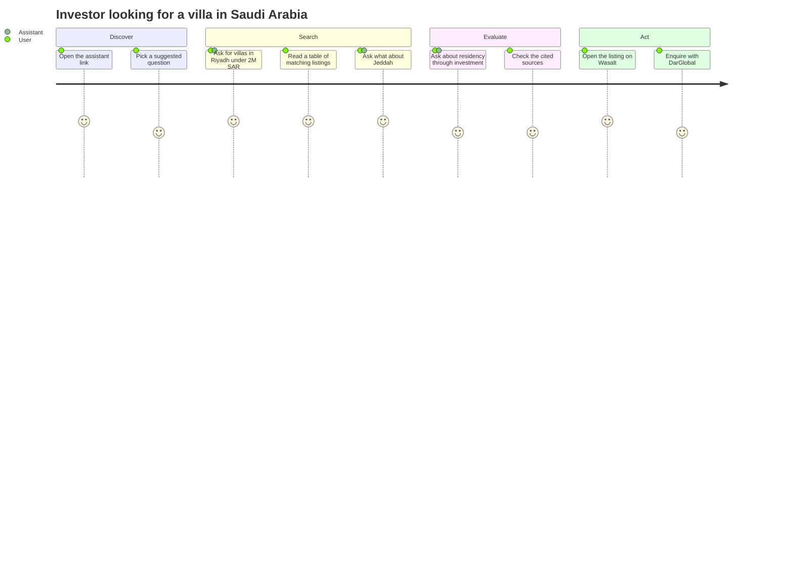

### 1.4 Value and constraints

| Goal | How the design supports it |
|---|---|
| Answers people can trust | Retrieval-augmented: the model only sees retrieved documents, and every fact carries an `[n]` link to its source page |
| Respect budgets and criteria | Price, city, type and bedrooms are applied as strict filters in code, never left to the model |
| Zero running cost | Free OpenRouter models, a free CPU embedding model, free Render hosting |
| Always available for reviewers | The data is scraped offline and shipped inside the image, so the demo doesn't depend on the source sites being up |
| Responsible data use | Only public pages, robots.txt respected, polite rate, bot protection not bypassed |

---

## 2. Technical architecture

### 2.1 High-level architecture

The system has two halves. The **offline data plane** runs on a developer machine and turns
the websites into a search index committed to git. The **online serving plane** is a single
container that answers questions from that index.

```mermaid
flowchart LR
    subgraph EXT1["Source websites"]
        DGW["darglobal.co.uk"]
        WSW["wasalt.sa"]
        WSC["cdn.wasalt.sa<br/>public sitemaps"]
    end

    subgraph OFF["Offline data plane: developer machine"]
        direction TB
        SCR["Scrapers<br/>browser extractors + sitemap script"]
        RAW[("data/raw<br/>JSON / JSONL")]
        DOCS["build_documents<br/>clean, dedupe, chunk, normalise"]
        PROC[("data/processed<br/>documents.jsonl")]
        IDX["build_index<br/>embed, atomic write"]
        INDEX[("data/index<br/>docs + vectors + manifest")]
        SCR --> RAW --> DOCS --> PROC --> IDX --> INDEX
    end

    GIT[("Git repository")]

    subgraph ON["Online serving plane: Docker container on Render"]
        direction TB
        UI["Web UI<br/>static HTML/JS"]
        API["FastAPI<br/>/api/chat, /api/health"]
        RAG["RAG core<br/>parse, retrieve, prompt"]
        LLMC["LLM client<br/>stream + fallback"]
        MEM[("In-memory index<br/>BM25 + vectors")]
        UI <--> API --> RAG --> LLMC
        RAG --> MEM
    end

    OR["OpenRouter<br/>free LLMs"]
    USER(("User browser"))

    DGW --> SCR
    WSW --> SCR
    WSC --> SCR
    INDEX --> GIT --> |"git push, Docker build"| ON
    USER <--> |"HTTPS, SSE stream"| UI
    LLMC <--> |"HTTPS, SSE stream"| OR
```

### 2.2 Technology choices

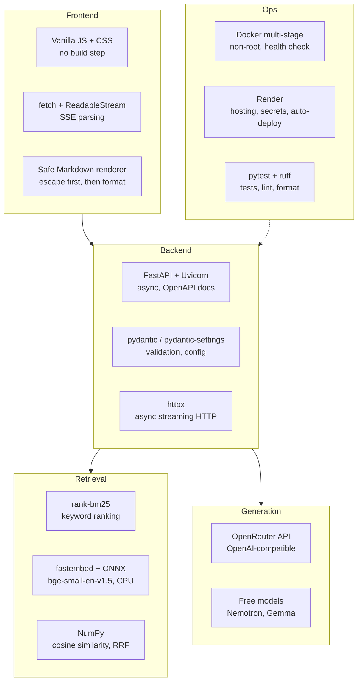

---

## 3. Detailed system design

### 3.1 Component diagram

Each box is a module in the repository. Arrows mean "calls" or "depends on".

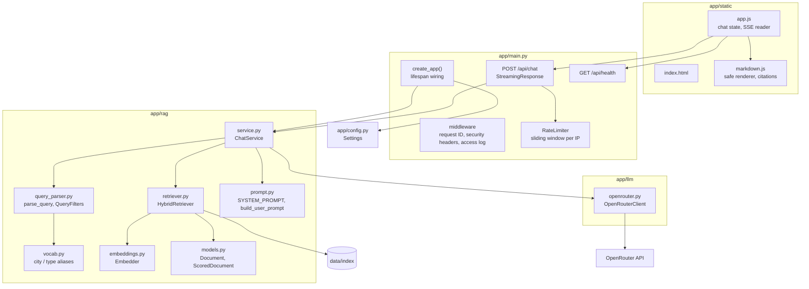

### 3.2 Request sequence: `POST /api/chat`

The full path of one question, including the streaming protocol and the model fallback.

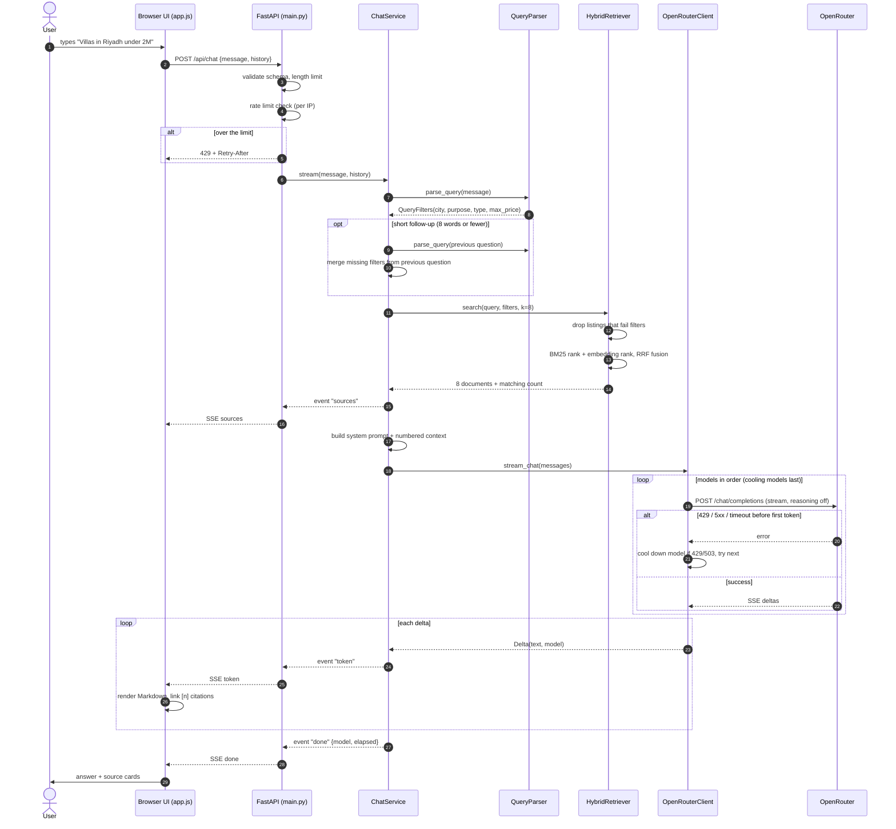

### 3.3 Retrieval algorithm

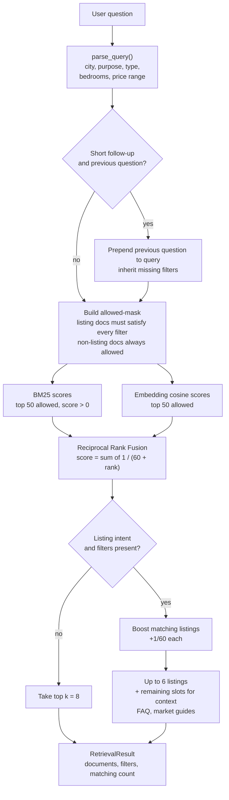

Why each part exists:

| Step | Reason |
|---|---|
| Filters before ranking | "Under 2 million" must be a guarantee, not a suggestion to the model |
| BM25 | Exact names and numbers ("Pagani", "W Residences", listing IDs) |
| Embeddings | Meaning and paraphrases ("place to live near the sea" ↔ "seafront residences") |
| RRF | Combines two rankings with different score scales, no tuning needed |
| Listing / context split | Users get both concrete listings and background (price norms, FAQs) |

### 3.4 LLM client: fallback and cool-down

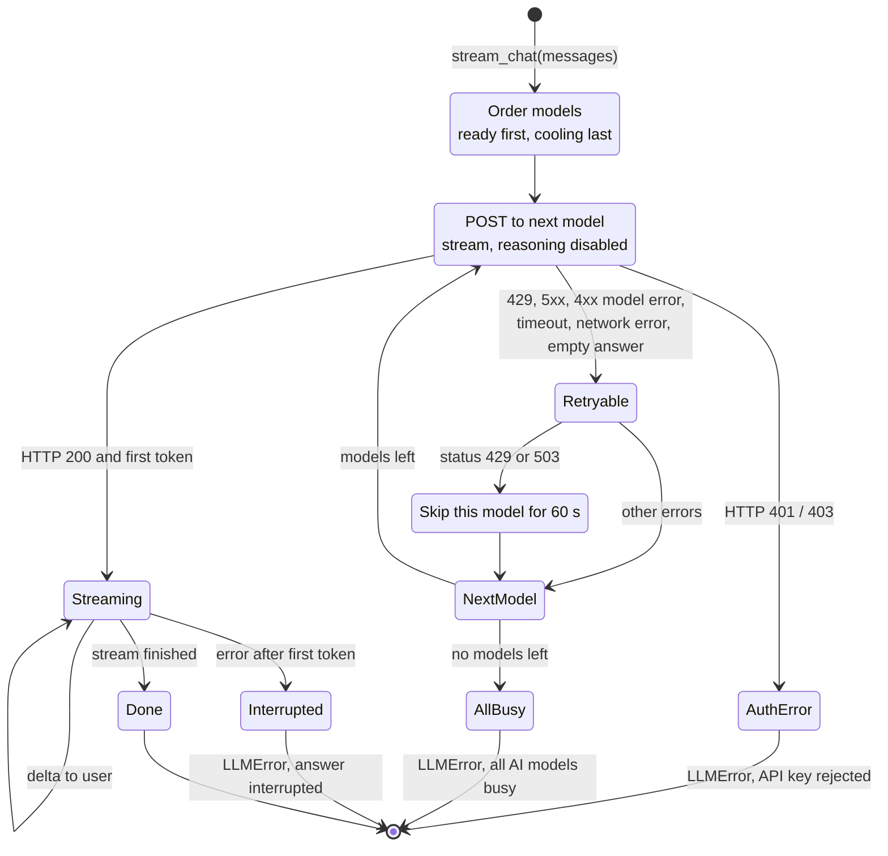

Design rule: **never switch models after the first token**. An answer stitched together from
two models would be incoherent, so a mid-stream failure is reported to the user instead.

### 3.5 Offline data pipeline

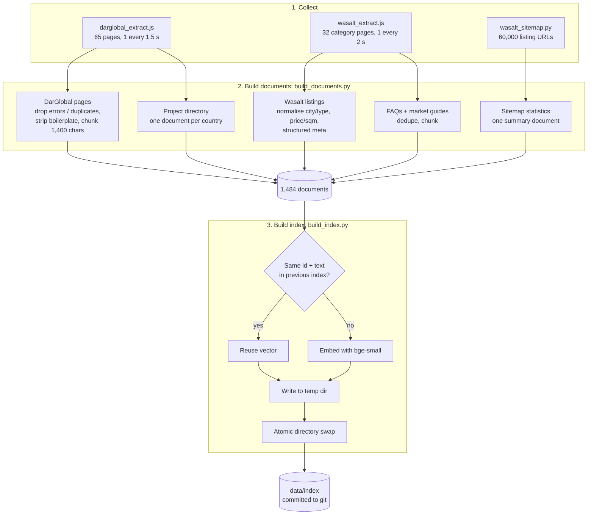

### 3.6 Data model

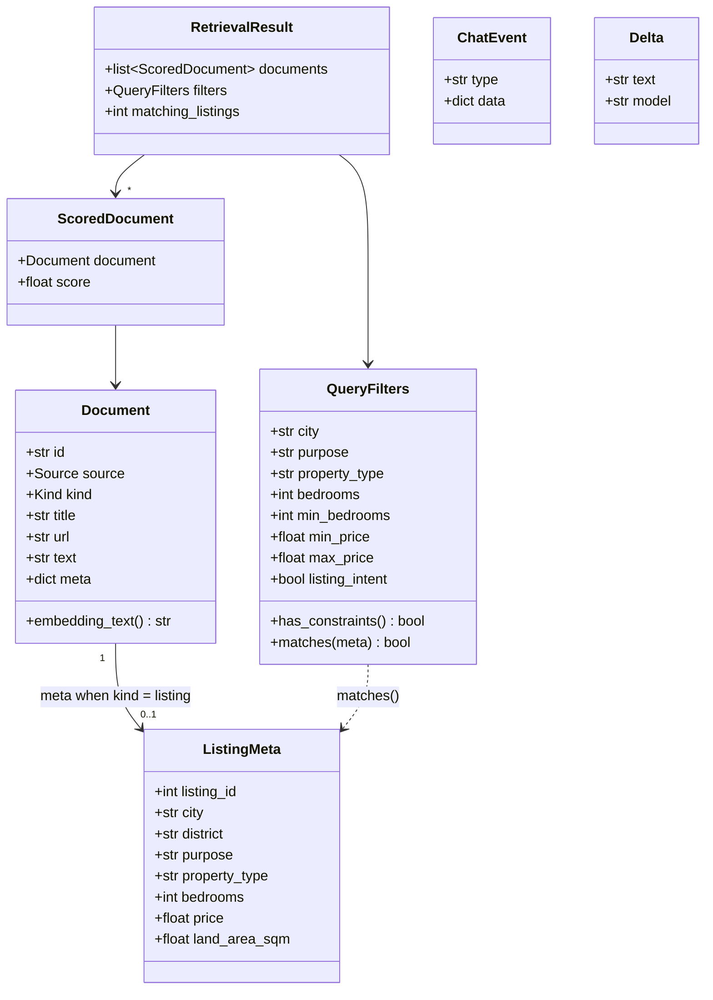

Allowed values:

| Field | Values |
|---|---|
| `Document.source` | `darglobal`, `wasalt` |
| `Document.kind` | `project`, `page`, `catalogue`, `listing`, `faq`, `market_guide`, `market_stats` |
| `ListingMeta.purpose` | `sale`, `rent` |
| `ListingMeta.property_type` | `Villa`, `Apartment`, `Land`, `Building`, `Floor` (normalised by `vocab.py`) |
| `ChatEvent.type` | `sources`, `token`, `done`, `error` |

### 3.7 Streaming protocol (Server-Sent Events)

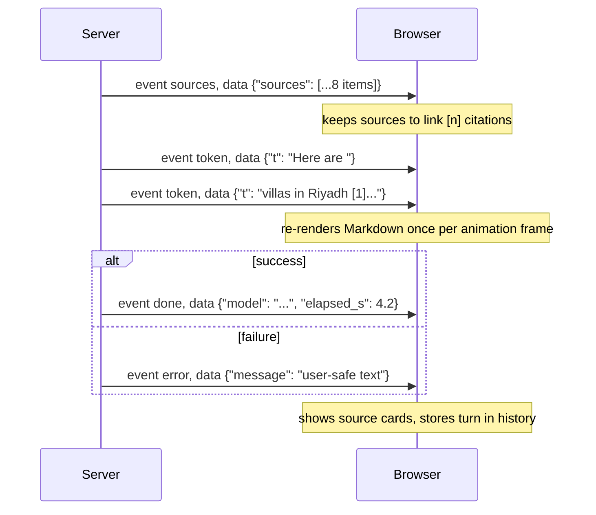

### 3.8 Deployment

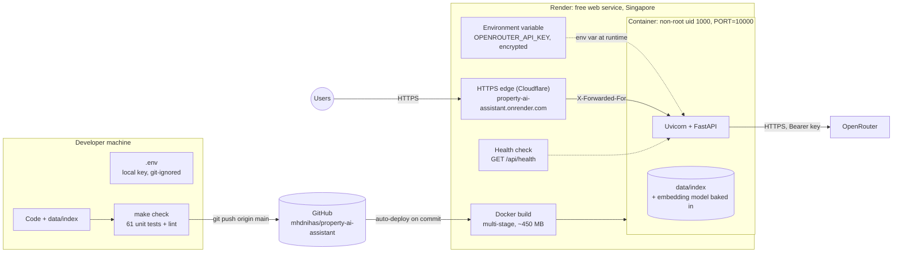

### 3.9 Failure modes and how they are handled

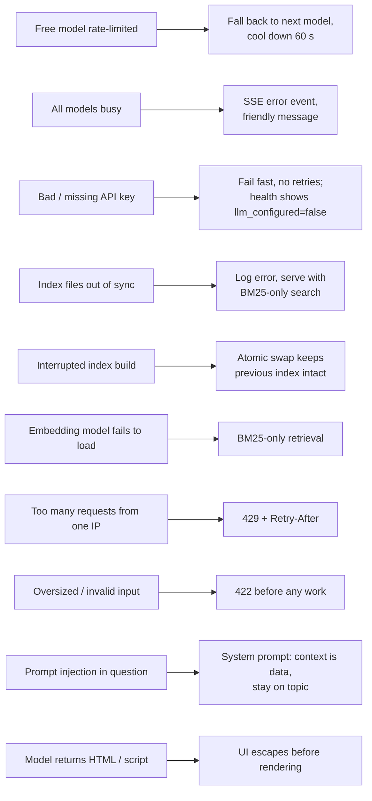

### 3.10 Scaling path

The current design targets a demo with one replica. If traffic grows, the changes would be:

| Concern | Today | At scale |
|---|---|---|
| Rate limiting | In-memory per process | Redis or the API gateway |
| Index | Loaded in memory (~2 MB of vectors) | Vector database (pgvector, Qdrant) once there are millions of listings |
| Freshness | Manual re-scrape | Scheduled job: scrape, build, test, deploy |
| LLM cost / limits | Free models, ~50 requests/day per free key | Paid key or self-hosted model, response cache for repeated questions |
| Observability | Structured logs with request IDs | Metrics (latency, model used, fallback rate) and tracing |
| Quality | Smoke test with 7 questions | Evaluation set with expected sources, run in CI |
