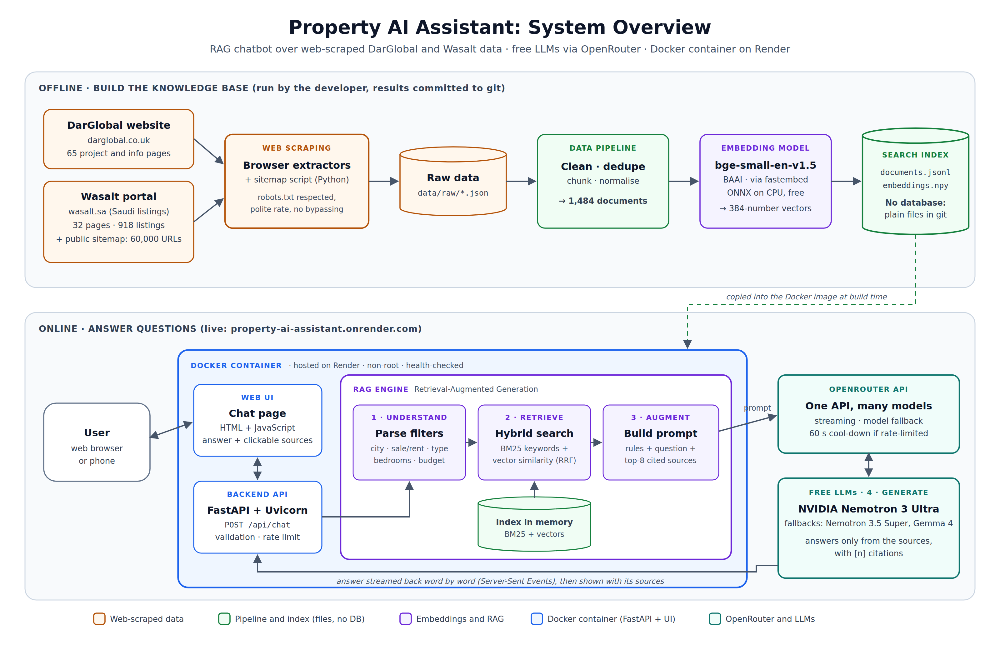
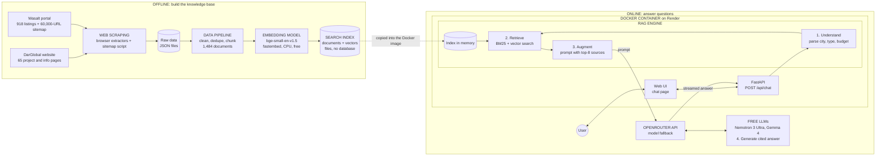

# System Overview

A one-page view of how the Property AI Assistant works: **web-scraped data → RAG → free LLMs
via OpenRouter**, served from a **Docker** container. For the detailed design see
[ARCHITECTURE.md](ARCHITECTURE.md).

*Image files: [overview.png](overview.png) (for email and slides) and
[overview.svg](overview.svg) (scales to any size).*

## Mermaid version

## In one paragraph

Public pages from **DarGlobal** and **Wasalt** were **web-scraped** and cleaned into 1,484
documents. Each document was turned into a vector by a free **embedding model**
(`bge-small-en-v1.5`), and the index is stored as plain files, so there's **no database**.
At runtime a **Docker** container on Render serves the chat page and a FastAPI backend. For
each question, the **RAG** engine parses the filters (city, budget…), retrieves the best
documents with hybrid keyword + vector search, and sends them with the question through
**OpenRouter** to a free **LLM**, which writes an answer that uses only those sources and
cites them. The answer streams back to the browser word by word.

| Component | Technology | Where in the code |
|---|---|---|
| Web scraping | Browser extractors (JS), sitemap script (Python) | `scraper/` |
| Data pipeline | Python | `pipeline/build_documents.py` |
| Embedding model | `BAAI/bge-small-en-v1.5` via fastembed (ONNX, CPU) | `app/rag/embeddings.py`, `pipeline/build_index.py` |
| Database | **None**: index files (`documents.jsonl`, `embeddings.npy`) | `data/index/` |
| RAG engine | Filters + hybrid BM25/vector search (RRF) + grounded prompt | `app/rag/` |
| LLM gateway | OpenRouter (free models, fallback, cool-down) | `app/llm/openrouter.py` |
| LLMs | NVIDIA Nemotron 3 Ultra (fallbacks: Nemotron 3.5 Super, Gemma 4) | `OPENROUTER_MODELS` setting |
| Backend + UI | FastAPI, Server-Sent Events, vanilla JS | `app/main.py`, `app/static/` |
| Container + hosting | Docker (multi-stage, non-root) on Render | `Dockerfile` |
